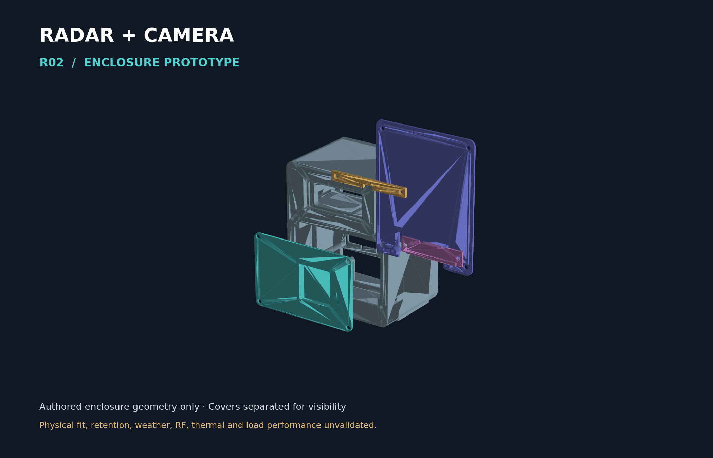

# Radar + Camera Enclosure · R02

Source-available, no-resale prototype enclosure for a TI IWR6843AOPEVM Rev G radar board and a Logitech C920e camera. Designed to Christopher Kalkowski's specifications. Editable CadQuery source, STEP solids and STL meshes are included.



**Fit-check prototype, not fabrication-certified. Actual C920e fit and retention are unvalidated.** The image shows authored enclosure geometry only, with covers separated for visibility; no device models are distributed.

## Start here

- [Print and assembly handoff](docs/PRINT_AND_ASSEMBLY_NOTES.md)
- [Bill of materials](docs/BOM.md)
- [Source and third-party exclusions](docs/THIRD_PARTY_REFERENCES.md)
- [Historical mechanical review](docs/INDEPENDENT_MECHANICAL_REVIEW.md)
- [License](LICENSE) and [changelog](CHANGELOG.md)

## Files and units

Everything is in **millimetres**. STL has no embedded unit convention: explicitly select mm in your slicer. Coordinates: X width, Y up, Z rearward; front outside surface Z=0.

- `cad/build_enclosure.py`: editable parametric CadQuery source. `cad/parameters.json` supplies configuration; additional dimensions are in the Python source.
- `cad/step/`: eleven individual editable solid exports: seven installed part types and four optional fit coupons.
- `cad/stl/`: matching eleven prototype meshes.
- `cad/assembly.step`: five main parts and twelve positioned screws. **The two PCB pins are omitted from this assembly export.** It is not a complete nineteen-piece assembly.
- `cad/validation.json`: original source-build solid-validity report.
- `cad/stl_validation.json`: refreshed edge-manifold mesh checks. These are not printability, strength or fit tests.
- `docs/PUBLICATION_VALIDATION.json`: this package's independent checks.
- `SHA256SUMS.txt`: checksums for every distributed file except the manifest itself.

Body envelope is 170 × 210 × 125 mm; assembled envelope including screw heads is 170 × 210 × 142 mm. Main skin is nominally 1 mm. The integral radar window is nominally 0.30 mm. Printed custom Ø6 / pitch 2 screws are **not standard M6 hardware**.

## Rebuild

Use Python and CadQuery 2.5 or newer from its official distribution. From the repository root:

```sh
python -m pip install 'cadquery>=2.5'
python cad/build_enclosure.py
python cad/check_stl.py
```

Rebuilding overwrites `cad/stl/`, `cad/step/`, assembly and validation outputs. Run in a copy if you want to preserve the supplied exports. The generator constructs intermediate features and then consolidates the final R02 geometry; only the seven final installed part types and four coupons export. Changing dimensions requires renewed collision, manufacturing and physical checks. The published source has been syntax-checked; this release preserves the prior CAD exports rather than claiming a fresh full parametric rebuild.

To reproduce the enclosure-only preview, install Matplotlib and NumPy from their official package distributions, then run `python tools/render_preview.py`. This does not need third-party device meshes.

## Known limitations and release gates

- The nominal C920e including-clip envelope is **94 × 43.3 × 71 mm**. It is not a measured lens datum, clip pose or housing contact surface.
- A separately obtained community C920 proxy measures about 93.9866 × 44.5 × 68.51 mm. It is an approximate C920e reference, not a manufacturer-certified C920e model. Prior digital checks report 0.750 mm minimum shell clearance and a **5.612 mm keeper gap**. This does not establish retention. The handoff's 2 mm keeper clearance refers to the different nominal box, not the detailed proxy.
- Camera clip articulation, optical/microphone clearance, housing-safe pads, cable routing, heatsink and actual assembled-device fit remain unvalidated.
- Thin-wall manufacture, the 0.30 mm radar window, RF transmission, sealing/weather resistance, thermal behavior and tripod/fastener load, creep and fatigue are **untested**. There is no IP rating or fabrication certification. Do not rely on geometric validity as evidence of safety or manufacturability.
- The official TI model was spatially classified in earlier fit work; it was not a certified complete isolated radar subassembly. Its derived mesh is withheld here.
- No DCA1000 stack, GPS module, optional electronics, production tolerances or sensor-performance guarantees are included.

Before fabricating, have the provider review supports, 1 mm skins and the fragile window. Print thread coupons first, physically measure the actual devices, then perform empty-enclosure fit, leak, thermal, RF-comparison and load tests appropriate to the intended use. See the handoff for detailed cautions.

## License in plain language

Personal, teaching and internal business use and free redistribution are allowed under [LICENSE](LICENSE). You may pay a print shop to fabricate copies for your own permitted use; it may charge for that customer-directed fabrication service. Independently manufacturing stock, listing/reselling enclosures or modified physical derivatives, or selling commercial products incorporating them requires separate permission. Third-party rights remain separate. This is **source-available**, not OSI-approved open source.

### Examples

- An individual may modify the design for personal use or research and pay a print shop to fabricate it.
- A company may modify it and pay for fabrication for its own internal research or internal business use.
- A print shop may charge that customer for the requested fabrication, materials and labor. It may not independently manufacture stock or list the enclosure for sale.
- Neither the company nor the print shop may resell the CAD, modified design, physical enclosure or modified physical derivative as a product without permission.
- Your datasets, research findings, trained models and independently created software remain yours to keep, use, share or sell, subject to others' independently applicable rights and laws. Chris claims no rights merely because you used the enclosure/radar. The no-resale restriction covers the enclosure design and its physical copies, not independent downstream outputs. Any dataset contribution is separate and opt-in.
